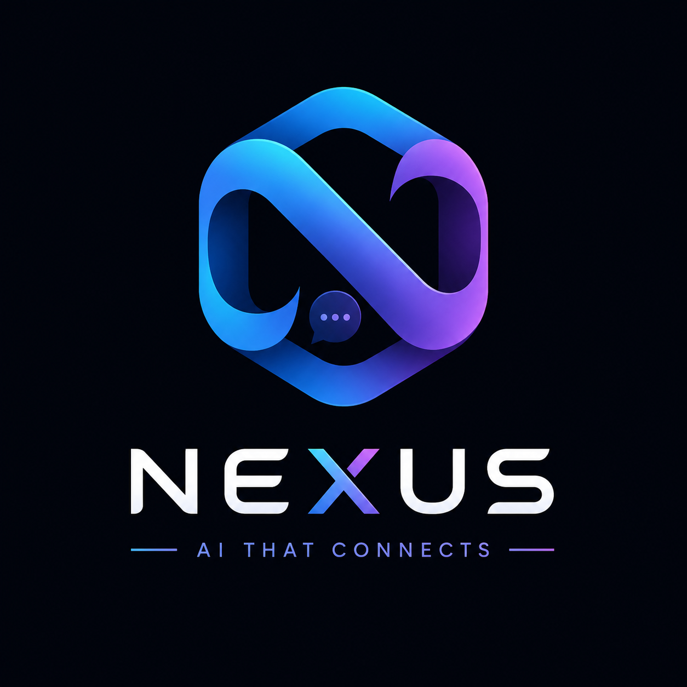

<div align="center">



# NEXUS AI

**One AI. Infinite connections.**

A full-stack AI super app — 13 abilities, 27 live connectors, a real code sandbox, AI video generation, and a real email agent.

</div>

## ✨ Abilities

| | | |
|---|---|---|
| 💬 **AI Chat** — deep thinking mode, Markdown answers | 🎙️ **Live Voice** — real-time conversation in 12 languages | 🤖 **Agent** — autonomous tool-calling with 27 connectors |
| 💻 **Code Studio** — real sandbox (JS/TS/Python) + AI assist | 🎬 **Video Studio** — AI-directed MP4s with narration | 🎨 **Image Studio** — dual providers |
| 📄 **Office Studio** — real Word/Excel/PowerPoint with premium templates | 👁️ **Vision** — image understanding | 🔍 **Web Search** — live results + AI digest |
| 📖 **Page Reader** — clean extraction | 🗣️ **Voice Studio** — 40+ neural voices, TTS + ASR | 🧠 **AI Models** — bring your own free API keys |

## 🆕 Latest Upgrades

| | |
|---|---|
| 📞 **AI Voice Call** — a true real-time phone call with NEXUS: socket.io streaming pipeline (ASR → LLM → TTS), animated call screen with timer, mute & barge-in interruption, live captions, and a captions-mode fallback when the mic is unavailable. | 🪄 **AI Photo Studio** — edit any photo with a sentence (remove background, restore & colorize old photos, cinematic grade, headshots…) powered by the free built-in image-edit engine, plus **Stock Photos** search across the open web (Z.ai engine with an Openverse fallback — always source-attributed). |
| 🎬 **Video Intelligence** — upload or link a video and NEXUS *watches* it: scene-by-scene breakdown, objects & people, on-screen text, mood & pacing — then answers your follow-up questions with timestamps. | ⚡ **Z.ai gateway re-enabled (Vercel-safe)** — the millisecond sandbox engine is back via config-file detection: zero network attempts on Vercel (premium engines take over), full multimodal power (chat, TTS, ASR, vision, image edit/search) in the sandbox. |

## 🔌 27 Live Connectors

**Web & Data**: Web Search · Read Page · Weather · Forecast · Rocket Launches · World News (BBC) · Steam Games
**Knowledge**: Wikipedia · Dictionary · Translator · arXiv · NASA · Recipes · Pokédex · Trivia
**Finance**: Crypto (Coinbase) · Currency Rates
**Developer**: GitHub · Hacker News
**Utility**: Calculator · Time · Geocoder · Image Generation
**Email (real)**: Inbox list · Search · Read · Send — via your own IMAP/SMTP account

## 🏗️ Tech Stack

- **Next.js 16** (App Router) + **TypeScript** — the whole app lives on one route
- **shadcn/ui** semantic design system — Claude-inspired warm ivory theme
- **Prisma + SQLite** — sessions, messages, images, encrypted accounts
- **Real execution**: Bun/CPython sandbox with timeouts, ffmpeg video pipeline
- **Security**: AES-256-GCM encrypted credentials, per-IP rate limiting, zod validation, prompt-injection hardening

## 🚀 Getting Started

```bash
bun install
bun run db:push     # create the SQLite schema
bun run dev         # start on :3000
```

Optional — plug in free AI provider keys in **AI Models** (OpenRouter, Groq, Gemini, Mistral, Cerebras, Together) and connect your email in **Connectors**.

## 📁 Structure

```
src/
├── app/            # API routes (chat, agent, code, video, office, email, tts…) + page.tsx
├── components/omni # 13 ability UIs + design system
└── lib/            # connectors registry, email (IMAP/SMTP), AI providers, sandbox helpers
prisma/             # schema (ChatSession, ChatMessage, GeneratedImage, EmailAccount, AiProvider)
```

---

Built with Z.ai frontier models. Generated content stays local; credentials are encrypted at rest.
